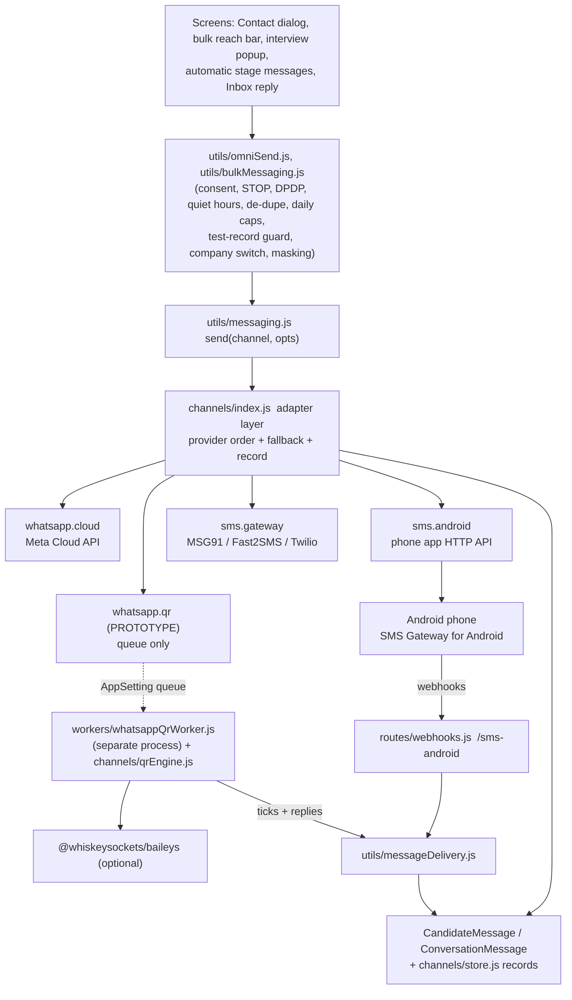
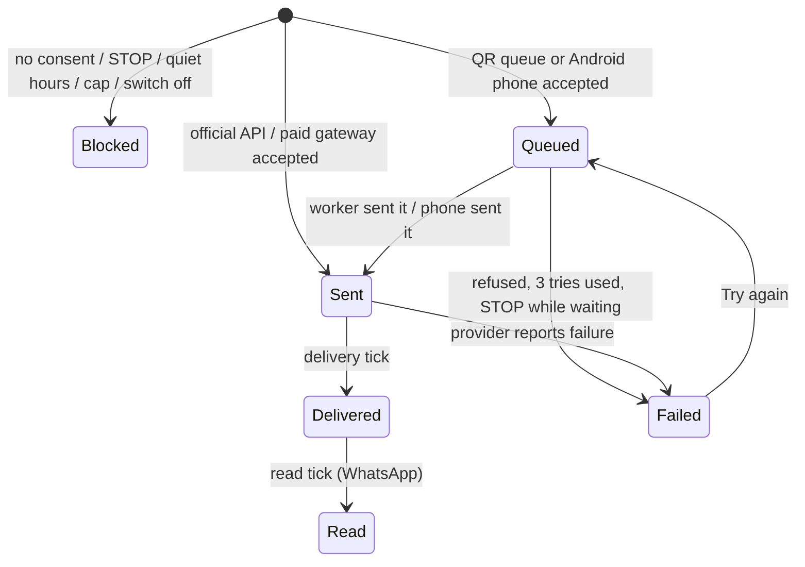
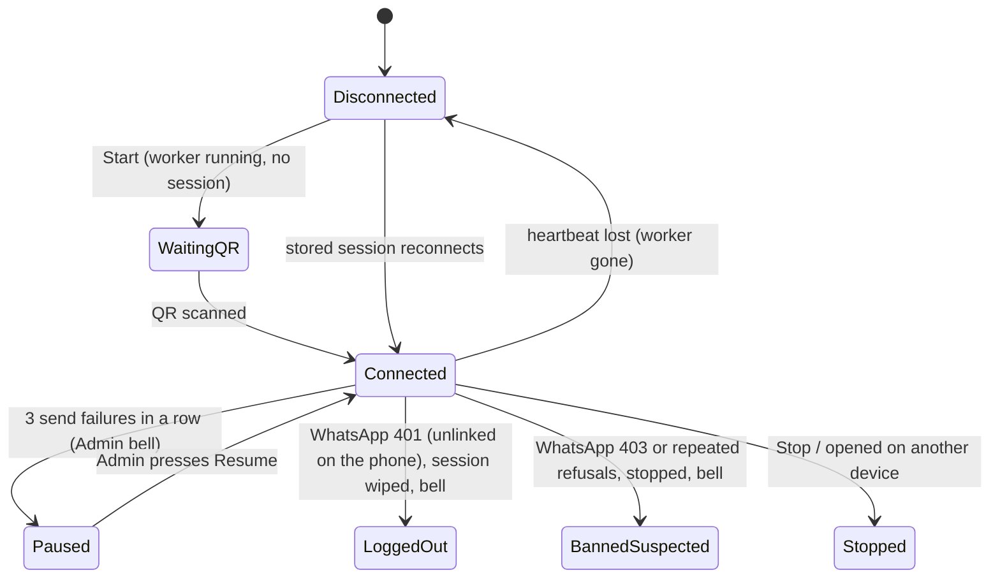
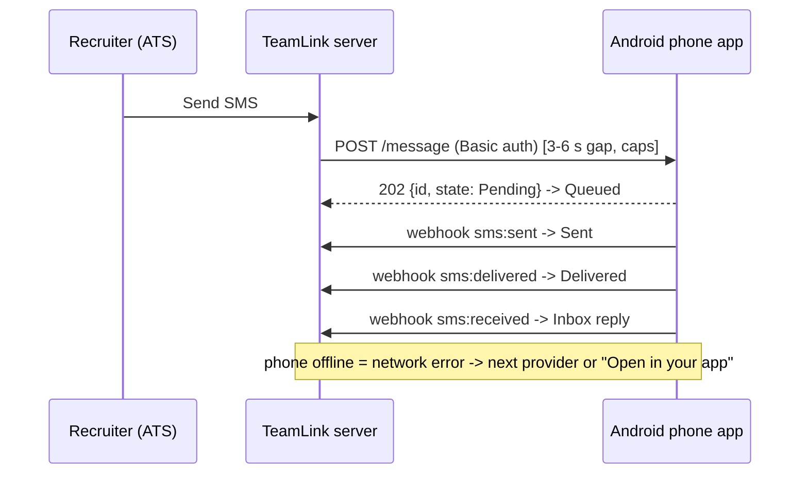

# Communication Automation: architecture

Recruiters send WhatsApp and SMS **straight from the ATS**. Nothing opens another app unless no provider is connected.
Every message is tracked in the ATS.

## The layers



* `channels/index.js` is the only door for WhatsApp and SMS. `utils/messaging.js` calls it, so every old caller (bulk send,
  automatic messages, the Inbox, the interview popup) uses it without change. `channels/send.js` is the small door for other modules.
* Providers share one shape: `send(message) -> { ok, providerRef, status, error, retryable }`, plus `config()`, `health()`, `test()`.
  Connect / disconnect are the Integration row (`enabled` / `connected`) and the Admin buttons in `routes/comm.js`.
* **Provider order** per channel lives in `comm.settings` (AppSetting): the first provider and "try the other one if it is not
  available". A message goes to the first provider that is ready. If it fails for a reason that is not about the person (offline, daily
  cap, refused, not set up) the next one is tried. If the person must not get it (no consent, STOP, bad number) no other provider is tried.
  If nothing can send, the caller gets `{ ok:false, notConfigured:true }` and the screens offer "Open in your app".
* The planner (`bulkMessaging.buildPlan`) is provider-aware: with the QR number first, WhatsApp text needs no approved template;
  with the official API first and no approved template, plain text is routed to the QR number when it is connected; with an Android
  phone first, SMS is plain text (no DLT template).

## Data (no migration needed)

| What | Where |
|---|---|
| provider choice, company switches, caps, "I understand" | `AppSetting comm.settings` |
| Android phone login (password and webhook key encrypted) | `Integration sms-android` (`utils/integrationStore.js`) |
| QR switch | `Integration whatsapp-qr` (`enabled`) |
| QR worker state + QR string | `AppSetting comm.qr.state` (heartbeat) |
| Admin commands to the worker | `AppSetting comm.qr.control` |
| QR send queue | `AppSetting comm.q.qr.<id>` (queued / sending / sent / failed) |
| WhatsApp message id to our queue ref | `AppSetting comm.qrwa.<id>` |
| per-message record: provider, status history, sender, retries, attachments, cost | `AppSetting comm.m.<yyyymmdd>.<id>` + `comm.ref.<providerRef>` (`channels/store.js`) |
| the message itself + its status | `CandidateMessage` (candidates), `ConversationMessage` (clients, employees) |
| encrypted QR session | files in `~/.teamlink/whatsapp-qr-session/*.enc` (outside git) |

### Migration path (when volume grows)

`channels/store.js` is the only file that touches the comm records. To move to a table, add (additive; rollback = drop it):

```sql
CREATE TABLE "CommMessage" (
  "id" TEXT PRIMARY KEY, "at" DATETIME NOT NULL, "direction" TEXT NOT NULL, "channel" TEXT NOT NULL, "provider" TEXT,
  "toAddress" TEXT, "personType" TEXT, "personId" TEXT, "personName" TEXT, "senderUserId" TEXT, "senderName" TEXT,
  "template" TEXT, "status" TEXT NOT NULL, "error" TEXT, "providerRef" TEXT, "jobId" TEXT, "retries" INTEGER NOT NULL DEFAULT 0,
  "attachments" TEXT, "cost" REAL, "history" TEXT NOT NULL);
CREATE INDEX "CommMessage_at" ON "CommMessage"("at");
CREATE UNIQUE INDEX "CommMessage_ref" ON "CommMessage"("providerRef");
```

and re-implement `record / byRef / applyStatus / alias / patch / list / usage / recordInbound` against it. Nothing else changes.

## State machines

### One message



A status never goes backwards (a late "delivered" does not undo "read"); "failed" always wins.

### WhatsApp QR link



### Android phone



## Queues and pacing

* QR queue: a DB-backed list (AppSetting rows). The worker is the only sender: one message at a time, random gap `gapMin..gapMax`
  (default 8-20 s), hourly cap (30) and daily cap (150), "new number" mode (10 / 40), optional typing pause, a "is this number on
  WhatsApp" check, up to 3 tries with 30 s x n delay, a circuit breaker after 3 failures in a row.
* Android: the bulk worker already sends one message at a time per channel; the adapter adds a 3-6 s gap and hourly / daily caps.
* The existing per-channel limits (`message-limits`, per minute and per day) still apply to every provider.

## Files

`backend/src/channels/` (`index`, `send`, `settings`, `store`, `whatsappQr`, `qrEngine`, `androidSms`, `androidWebhook`, `cloud`, `attachments`, `rateLimit`),
`backend/src/workers/whatsappQrWorker.js`, `backend/src/routes/comm.js`, `backend/src/utils/qrCode.js`,
`frontend/src/components/comm/*`, tests `backend/scripts/comm-automation-test.js`, fake library `backend/test-fixtures/fake-baileys.js`.
