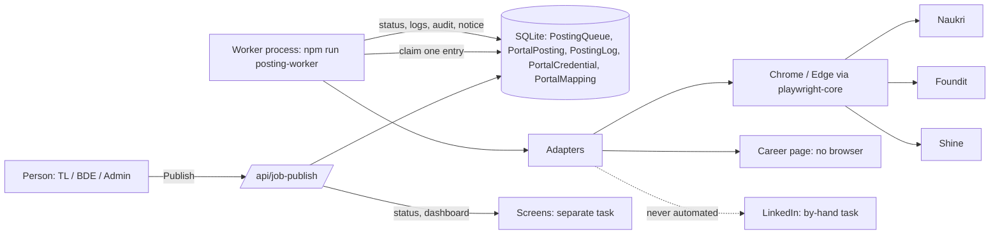
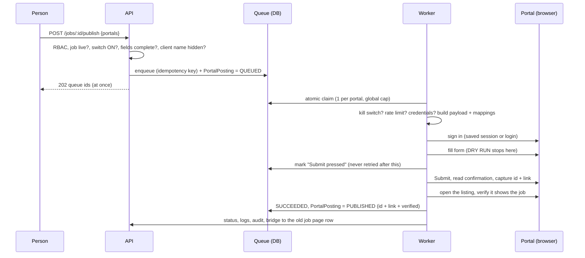
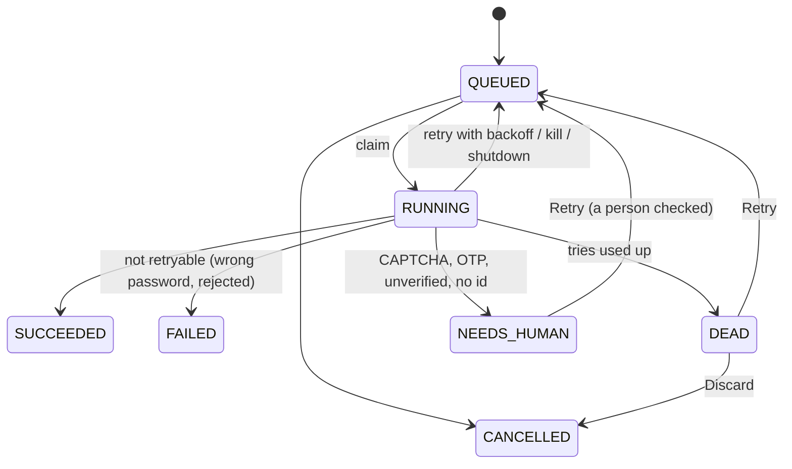
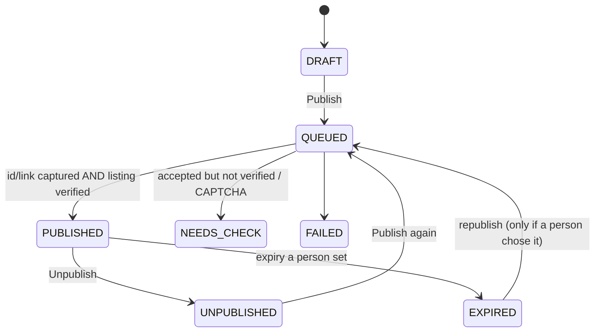
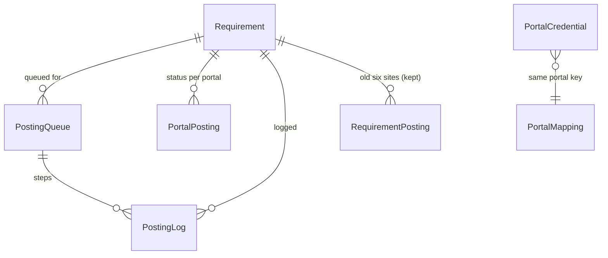

# Job publishing: high-level design

One job is written once in the ATS. A person who may post it (TL, BDE, BDE TL, Admin, Super Admin) picks the sites on one screen and presses **Publish**. The job goes into a database queue; a separate **worker** process posts it to each site and records what really happened.

## What exists and what was added

| Spec idea | Already in TeamLink (kept, untouched) | Added |
|---|---|---|
| jobs | `Requirement` | nothing |
| publish status per site | `RequirementPosting` (old six sites, by-hand tasks) | `PortalPosting` (new engine truth, 7 states) + a bridge that keeps the old rows honest |
| queue | none (background `setImmediate`) | `PostingQueue` + `src/jobPublish/queue.js` |
| logs | `AuditLog` | `PostingLog` (step by step, screenshots) |
| credentials | Integrations (`Integration.values`, AES-GCM) | `PortalCredential` (same `utils/secrets.js` key) |
| mappings | none | `PortalMapping` (252 seeded rows) |
| internal career page | `careersPublic.js`, Job Portal, `jobConnectors.js` | `InternalCareerAdapter` (reuses them) |
| Naukri / Shine / Foundit | partner-API connectors (wait for keys), by-hand | Playwright adapters (switch OFF by default) |
| LinkedIn | partner API (off), by-hand | structure only, **automation disabled** |

## System context

## Publish sequence

## State machines

## ER diagram

## Ten-line architecture

1. API only queues; it never posts and never starts a browser (except the career page, which needs none).
2. Queue = SQLite table; claim = one atomic `UPDATE ... RETURNING`; no Redis.
3. Worker = separate process, never started by `src/index.js`, refuses the real `dev.db` without `TL_ALLOW_REAL_POSTING=1`.
4. One browser at a time (global cap 1), one per portal; persistent profile per portal outside the repo.
5. Adapters share `BasePortal`; all selectors and URLs are JSON per portal, tunable without code.
6. Safety rules live in `BasePortal`: no CAPTCHA/OTP bypass, no stealth, Submit once, no retry after Submit, DRY RUN.
7. PUBLISHED = id/link captured + listing verified. Otherwise NEEDS_CHECK.
8. Credentials AES-256-GCM via `utils/secrets.js`; never in an answer, log, audit row or screenshot.
9. RBAC server side: post = may post the job; view = own area; credentials/switches/mappings = Admin / Super Admin.
10. Every command is an audit row; every run is a step log; the old by-hand task and job-page rows stay correct.
